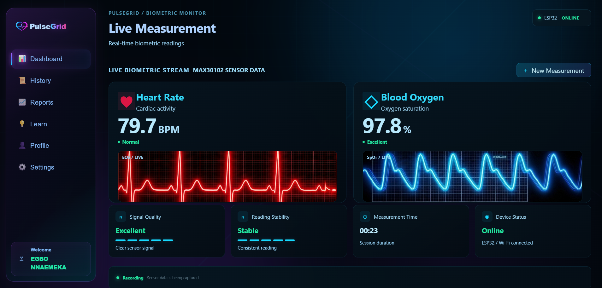
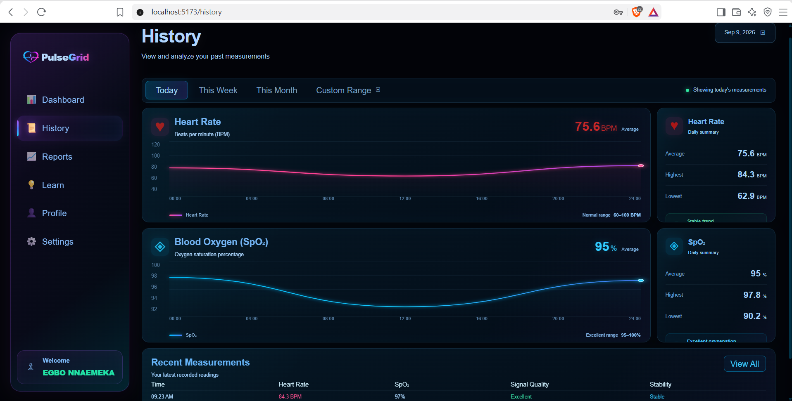
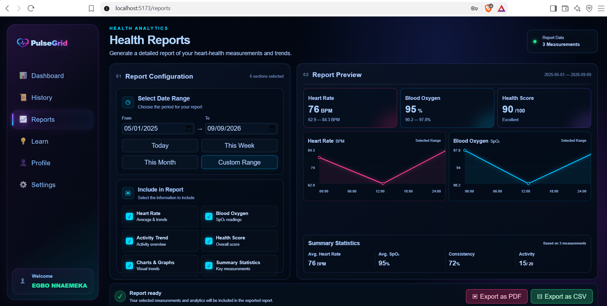

# PulseGrid

### Web-Based Heart Rate & Blood Oxygen Monitoring System

**PulseGrid** is a full-stack, IoT-enabled health monitoring system that seamlessly combines embedded systems, cloud computing, and modern web technologies. It features real-time physiological data capture from an optical sensor, processing via an **ESP32 microcontroller**, and low-latency visualization on a customized **React web application** powered by **Firebase**.

  *This project was developed as a practical implementation of an IoT ecosystem. It successfully bridges hardware and software engineering through low-level firmware signal conditioning, wireless data transmission via edge devices, and a real-time webapp, backed by a scalable, authenticated cloud data infrastructure.*

---

## Screenshots

### Register/Login


### Live Dashboard


### Measurement History


### Measurement Report


---

## Features

- **Physiological Sensing:** Real-time heart-rate (BPM) monitoring and blood oxygen (SpO₂) estimation via the MAX30102 sensor.
- **Edge Computing:** Hardware interrupt-driven pulse interval tracking using the ESP32 NodeMCU.
- **Cloud Architecture:** Secure user onboarding with Firebase Authentication and persistent session syncing.
- **Dynamic Database:** Scalable telemetry storage and query operations using Cloud Firestore.
- **Responsive Dashboard:** Modern user interface featuring multi-user view management, customizable profiles, historical reporting, and a built-in health education hub.

---

## System Architecture

```text
MAX30102 (Sensor)
   │
   │ I²C Communication
   ▼
ESP32 (Microcontroller)
   │
   │ Wi-Fi / HTTP Endpoint
   ▼
React Web Application
   │
   ▼
Firebase (Authentication + Cloud Firestore)
```

The **MAX30102** captures optical photoplethysmography (PPG) data, which is processed directly on the **ESP32** edge node. The ESP32 serves this localized telemetry through an HTTP endpoint, allowing the **React frontend** to poll or receive data in real time while managing structured state tracking within **Cloud Firestore** for historical analytics.

---

## Technology Stack

### Hardware & Firmware
- **Microcontroller:** ESP32 NodeMCU
- **Sensor:** MAX30102 Pulse Oximeter & Heart Rate Module
- **Language/Environment:** C/C++ via PlatformIO (Arduino Framework)
- **Protocol:** I²C Hardware Bus

### Frontend Web App
- **Core Library:** React 18 (built with Vite)
- **Routing & State:** React Router DOM
- **Styling:** Tailwind CSS & Framer Motion

### Cloud Backend
- **Identity Provider:** Firebase Authentication
- **Database Engine:** Cloud Firestore NoSQL Database

---

## Hardware Connections

| MAX30102 Pin | ESP32 GPIO | Description |
| :--- | :--- | :--- |
| **SDA** | GPIO 21 | Serial Data Line |
| **SCL** | GPIO 22 | Serial Clock Line |
| **VCC** | 3.3V | Input Power |
| **GND** | GND | Common Ground |

---

## Project Structure

```text
PulseGrid/
├── src/                 # React Web Application Source Code
│   ├── assets/          # Static media
│   ├── components/      # Reusable UI widgets
│   ├── context/         # React Global State providers
│   ├── firebase/        # Firebase initialization and Cloud Service hooks
│   ├── hooks/           # Custom React hooks
│   ├── layouts/         # Page shell containers
│   ├── pages/           # High-level route views
│   ├── services/        # External API wrappers and Firestore telemetry operations
│   ├── styles/          # Global styles, Tailwind directives, and CSS configurations
│   ├── utils/           # Shared helper functions
│   ├── App.jsx          # Master application component and route definitions
│   ├── index.css        # Global entry stylesheet
│   └── main.jsx         # React application execution entry point
│
├── esp32/               # Embedded C/C++ Firmware Application
│   ├── src/main.cpp     # Sensor data acquisition and Wi-Fi transmission logic
│   └── platformio.ini   # Firmware dependency and build environment profiles
├── public/              # Global static assets
├── .env                 # Environment variables
├── eslint.config.js     # Linter rules for enforcing code quality standards
├── index.html           # Main DOM injection target for the React application
├── package.json         # Node.js project manifest, build scripts, and dependencies
├── vite.config.js       # Vite bundler configurations and server routing optimization
└── README.md            # Repository documentation
```

---

## Getting Started

### Prerequisites
- **Node.js** (v18.x or higher)
- **VS Code** with the **PlatformIO IDE** extension installed (also works with Arduino IDE)

### 1. Web Application Setup
First, clone the repository and navigate to the project directory:
```bash
git clone https://github.com/chiefEGBO/PulseGrid.git
cd PulseGrid
```

Install the dependencies:
```bash
npm install
```

Create a `.env` file in the project root and add your configuration credentials:
```env
VITE_ESP32_URL=http://your_esp32_wifi_ip_address
```

Run the local development server:
```bash
npm run dev
```

### 2. ESP32 Firmware Installation
1. Launch **VS Code** and open the `esp32/` sub-directory.
2. Let **PlatformIO** automatically resolve and parse dependencies outlined in `platformio.ini`.
3. Open `src/main.cpp` and update the Wi-Fi credentials with your local network configurations:
   ```cpp
   const char* ssid = "YOUR_WIFI_SSID";
   const char* password = "YOUR_WIFI_PASSWORD";
   ```
4. Connect your ESP32 to your computer using a data-capable Micro-USB/USB-C cable.
5. Click the **PlatformIO: Upload** arrow icon in the bottom status bar to compile and flash the firmware.

---

## Limitations & Disclaimer

- **Hardware Dependency:** Live measurement pipelines rely directly on physical ESP32 and MAX30102 hardware nodes being connected to the same local area network.
- **Signal Constraints:** Dynamic readings are highly dependent on direct dermal contact, stable finger positioning, ambient noise isolation, and minimal physical movement.
- **Estimation Models:** SpO₂ metrics are calculated values optimized through sensor-derived software algorithms and serve as technical approximations.
- **Clinical Validation:** **PulseGrid is an academic engineering prototype.** It is not a clinically validated medical device and should never be used as a substitute for certified medical instruments or professional diagnostics. This system does not monitor blood pressure.

---
